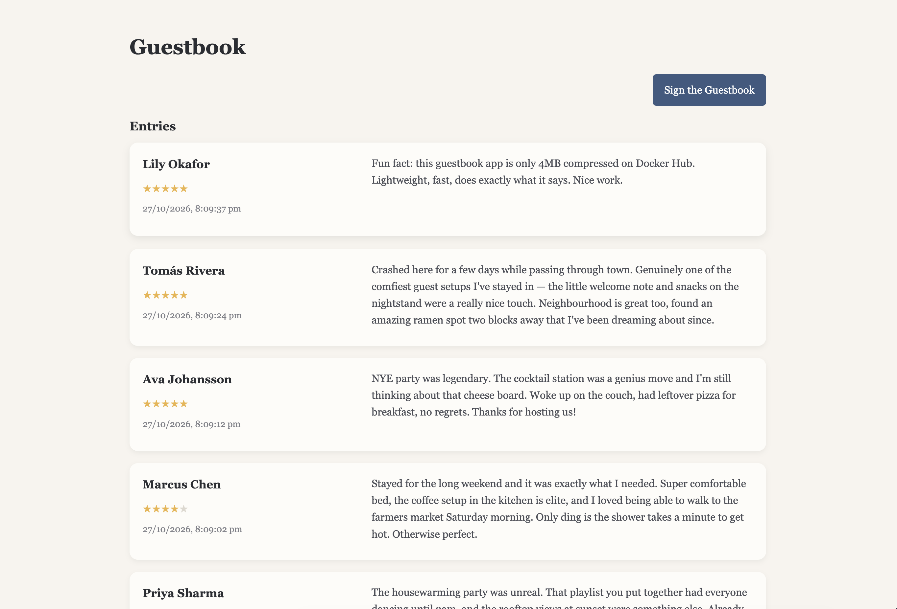

# Tiny Guestbook

A lightweight, self-hosted guestbook app that lets guests leave star ratings and reviews. Built with Rust and SQLite, the Docker image compresses down to just a few MB.



## Features

- Star ratings (1-5) with written reviews
- Sortable entries (by date or name)
- Responsive design for desktop and mobile
- SQLite database
- Multi-architecture Docker images (x86_64 and ARM64)

### A note on project goals

The goal here is being simple and small. This is not intended for deployment where users are untrusted. There is no vetting of what is posted, no rate limiting, no accounts, no accountability, and the `DELETE` endpoint is unauthenticated so anyone on the network with the app can delete posts. This is really just meant to be a fun thing at home for friends and family.

## Quick Start

Pull and run with Docker Compose:

```yaml
services:
  guestbook:
    image: owenelliottdev/tiny-guestbook:latest
    container_name: tiny-guestbook
    ports:
      - "8080:8080"
    volumes:
      - ./data:/app/data
    restart: unless-stopped
```

```bash
docker compose up -d
```

The guestbook will be available at `http://localhost:8080`. The SQLite database is stored in `/app/data`, so map that volume to persist data across restarts.

## Colour Themes

Set the `THEME` environment variable to pick a colour scheme:

```yaml
    environment:
      - THEME=sage-linen
```
__Available Themes:__
+ `default`
+ `sage-linen`
+ `harbour-mist`
+ `lavender-dusk`
+ `eucalyptus`
+ `stone-fog`
+ `dusty-rose`
+ `matcha`
+ `denim-oat`
+ `seafoam`
+ `terracotta`
+ `moonlit`
+ `midnight-forest`

To use your own theme, copy one of the files in `static/css/themes/`, change the colours, and mount it into the container:

```yaml
    volumes:
      - ./data:/app/data
      - ./my-theme.css:/app/static/css/themes/custom.css
    environment:
      - THEME=custom
```

Your custom CSS file can have any name but `THEME` must be the name you used minus the `.css`.

### Advanced Styling

A custom theme can contain any CSS, not just colour variables. Themes are loaded last; rules in your theme can override the main `static/css/style.css` sheet provided they use the same selector (or a more specific one).

## Building from Source

### Docker

```bash
docker build -t guestbook .
docker run -p 8080:8080 guestbook
```

Or use the dev compose file:

```bash
docker compose -f docker-compose-dev.yml build
docker compose -f docker-compose-dev.yml up
```

### Local Development

Requires Rust.

```bash
cargo run
```

## API

| Method | Endpoint | Description |
|--------|----------|-------------|
| `GET` | `/` | Main guestbook page |
| `GET` | `/sign` | Signing form |
| `POST` | `/api/sign` | Submit a new entry |
| `GET` | `/api/entries?sort=<order>` | Fetch entries (datePostedDesc, datePostedAsc, nameDesc, nameAsc) |
| `GET` | `/api/entry?id=<id>` | Fetch a single entry |
| `DELETE` | `/api/entry?id=<id>` | Delete an entry |
